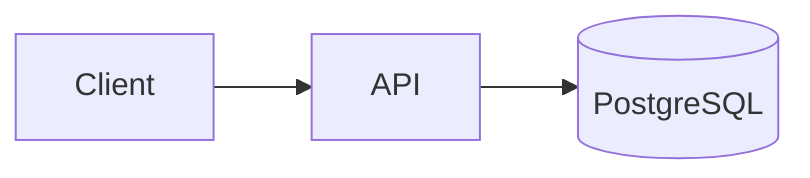

# Спецификация MCP-инструментов и REST API — Docalaizer

Документ фиксирует контракты взаимодействия между внешними AI-агентами (через **MCP**), веб-интерфейсом (через **REST API**) и ядром Docalaizer.

---

## 1. Подключение AI-агентов (MCP Server)

Сервер экспонирует **MCP Streamable HTTP** endpoint:

```text
POST /mcp
Authorization: Bearer doca_live_<token>
```

Для клиентов, которым нужен локальный `stdio`-транспорт, в будущем можно предоставить тонкий npm-bridge (`npx @docalaizer/mcp-bridge --url https://... --token ...`), но большинство современных клиентов (Claude Code, Cursor, T3 Code, Windsurf) поддерживают Streamable HTTP напрямую.

---

## 2. Каталог MCP-инструментов (Tools)

### 2.1. Работа с проектами

| Tool | Требуемый scope | Входные параметры | Описание |
|---|---|---|---|
| `list_projects` | `projects:read` | `{ query?: string }` | Список доступных агенту проектов (`id`, `slug`, `name`, `default_approval_policy`) |
| `create_project` | `projects:create` | `{ name, slug?, description?, icon?, default_approval_policy? }` | Создаёт новый проект (если агенту выдано право `projects:create`; иначе возвращает `403 FORBIDDEN_SCOPE`) |
| `get_project_tree` | `projects:read` | `{ project_id }` | Возвращает иерархическое дерево страниц проекта (`id`, `parent_id`, `title`, `slug`, `pending_proposals_count`) |

### 2.2. Чтение и поиск документации

| Tool | Требуемый scope | Входные параметры | Описание |
|---|---|---|---|
| `search_docs` | `docs:read` | `{ query, project_id?, limit? }` | Полнотекстовый поиск (PostgreSQL `tsvector`) по страницам в доступных проектах |
| `get_doc` | `docs:read` | `{ doc_id, format?: "blocks" \| "annotated_markdown" }` | Возвращает `head_revision_id`, метаданные страницы и содержимое с `block_id`, `contentHash`, `humanTouched`, `lockedByHuman` |
| `get_doc_history` | `docs:read` | `{ doc_id, limit?: number }` | Краткий лог последних ревизий (`revision_number`, `author_type`, `summary`, `created_at`) |

### 2.3. Создание и предложение правок (Proposals)

| Tool | Требуемый scope | Входные параметры | Описание |
|---|---|---|---|
| `create_doc` | `docs:create` | `{ project_id, parent_id?, title, slug?, icon?, blocks \| markdown, rationale? }` | Создаёт новую страницу. Если политика проекта `strict` — создаёт черновую страницу + `Proposal` на публикацию; если `protect_human` / `auto_new_docs` — публикует сразу как `v1` |
| `propose_changes` | `docs:propose` | `{ doc_id, base_revision_id, title, rationale, ops[], metadata_changes?, idempotency_key? }` | Создаёт блочный `Proposal`. Валидирует все графики/диаграммы, вычисляет `conflict_state` по каждому блоку |
| `propose_markdown_update` | `docs:propose` | `{ doc_id, base_revision_id, title, rationale, annotated_markdown, idempotency_key? }` | Принимает обновлённый Markdown (с `<!-- docalaizer:block ... -->` или без), сервер выравнивает блоки и строит `Proposal` |
| `validate_visualization` | `docs:read` | `{ type: "diagram" \| "chart", engine: "mermaid" \| "vega-lite", payload }` | Проверяет синтаксис Mermaid или JSON-схему Vega-Lite до отправки Proposal |

### 2.4. Обратная связь по ревью (Feedback Loop)

| Tool | Требуемый scope | Входные параметры | Описание |
|---|---|---|---|
| `list_proposals` | `docs:read` | `{ project_id?, doc_id?, status?: "pending" \| "all" }` | Список открытых/недавних заявок, чтобы агент не дублировал уже предложенные правки |
| `get_proposal` | `docs:read` | `{ proposal_id }` | Детали заявки, включая статус каждой операции (`accepted`/`rejected`) и **`review_comment`** человека |
| `update_proposal` | `docs:propose` | `{ proposal_id, base_revision_id?, ops[], rationale? }` | Обновляет открытый (`pending`) Proposal после замечаний пользователя |

---

## 3. Примеры контрактов MCP

### 3.1. `propose_changes` — запрос агента

```json
{
  "doc_id": "01JDX9A2K8...",
  "base_revision_id": "01JDX9B1M0...",
  "title": "Добавить схему очереди задач и график latency p95",
  "rationale": "Обновил документацию после внедрения worker-пула в PR #42",
  "idempotency_key": "pr-42-docs-update-v1",
  "ops": [
    {
      "op_type": "insert",
      "after_block_id": "blk_01JDX1...",
      "new_block": {
        "type": "diagram",
        "title": "Поток обработки задач",
        "content": {
          "engine": "mermaid",
          "source": "flowchart LR\n  API --> Queue[(Redis)]\n  Queue --> Worker --> DB[(Postgres)]"
        }
      }
    },
    {
      "op_type": "insert",
      "after_block_id": "blk_01JDX2...",
      "new_block": {
        "type": "chart",
        "title": "Latency p95 по дням (ms)",
        "content": {
          "engine": "vega-lite",
          "spec": {
            "$schema": "https://vega.github.io/schema/vega-lite/v5.json",
            "mark": { "type": "line", "point": true },
            "encoding": {
              "x": { "field": "day", "type": "ordinal", "title": "День" },
              "y": { "field": "p95_ms", "type": "quantitative", "title": "p95 (ms)" }
            }
          },
          "data": [
            { "day": "Mon", "p95_ms": 210 },
            { "day": "Tue", "p95_ms": 185 },
            { "day": "Wed", "p95_ms": 112 }
          ]
        }
      }
    }
  ]
}
```

### 3.2. `propose_changes` — ответ сервера

```json
{
  "proposal_id": "01JDX9Z9Q1...",
  "status": "pending",
  "review_url": "https://docs.example.com/projects/backend/proposals/01JDX9Z9Q1",
  "summary": {
    "total_ops": 2,
    "clean": 2,
    "human_protected": 0,
    "locked": 0,
    "stale_conflict": 0,
    "risky_delete": 0
  },
  "warnings": []
}
```

### 3.3. Структурированные ошибки для самоисправления AI

Если агент прислал битый график или не имеет прав на создание проекта, сервер возвращает машиночитаемый код:
- `FORBIDDEN_SCOPE` — у токена агента нет права (например, `projects:create` выключено владельцем).
- `PROJECT_ACCESS_DENIED` — проект не входит в `allowed_project_ids` агента.
- `CHART_VALIDATION_ERROR` — ошибка схемы Vega-Lite / синтаксиса Mermaid с массивом `details: [{ path, message }]`.
- `BASE_REVISION_NOT_FOUND` — неизвестный `base_revision_id`.
- `BLOCK_LOCKED_WARNING` — предупреждение в ответе Proposal, что затронут блок с `lockedByHuman = true`.

---

## 4. Формат аннотированного Markdown (`annotated_markdown`)

Для агентов, которым проще работать с цельным текстом страницы, `get_doc(format: "annotated_markdown")` отдаёт Markdown с маркерами блоков:

```markdown
<!-- docalaizer:block id="blk_01A" type="markdown" owner="human" locked="false" -->
## Архитектура авторизации
Используем короткоживущие сессии и scoped-токены для AI-агентов.
<!-- /docalaizer:block -->

<!-- docalaizer:block id="blk_01B" type="diagram" engine="mermaid" owner="ai" locked="false" -->

<!-- /docalaizer:block -->

<!-- docalaizer:block id="blk_01C" type="chart" engine="vega-lite" title="RPS" owner="ai" locked="false" -->
```vega-lite
{
  "$schema": "https://vega.github.io/schema/vega-lite/v5.json",
  "data": { "values": [{ "t": "10:00", "rps": 120 }, { "t": "11:00", "rps": 180 }] },
  "mark": "bar",
  "encoding": { "x": { "field": "t", "type": "ordinal" }, "y": { "field": "rps", "type": "quantitative" } }
}
```
<!-- /docalaizer:block -->
```

Агент может модифицировать этот документ и отправить обратно через `propose_markdown_update`. Парсер сопоставляет `id` блоков, автоматически определяет вставки/правки/удаления и помечает любые удалённые `owner="human"` блоки флагом `risky_delete`.

---

## 5. REST API (для Web UI и прямых интеграций)

Базовый префикс: `/api/v1`.

### Auth & Users
- `POST /auth/register`, `POST /auth/login`, `POST /auth/logout`, `GET /auth/me`

### Projects & Members
- `GET /projects`, `POST /projects`, `GET /projects/:projectId`, `PATCH /projects/:projectId`, `DELETE /projects/:projectId`
- `GET /projects/:projectId/members`, `POST /projects/:projectId/members`, `PATCH /projects/:projectId/members/:userId`, `DELETE /projects/:projectId/members/:userId`
- `GET /projects/:projectId/tree` — дерево документов проекта

### Documents & Revisions
- `POST /projects/:projectId/docs` — создать страницу
- `GET /docs/:docId` — получить актуальную ревизию + счётчик pending proposals
- `PATCH /docs/:docId` — ручное сохранение правок человека (создаёт новую ревизию, выставляет `humanTouched = true` на изменённых блоках)
- `PATCH /docs/:docId/blocks/:blockId/protection` — переключить `lockedByHuman` или сбросить `humanTouched` («передать под управление AI»)
- `PATCH /docs/:docId/move` — переместить страницу в дереве (`parent_id`, `sort_order`)
- `GET /docs/:docId/revisions` — история ревизий (фильтр `author_type=human|ai|merge`)
- `GET /docs/:docId/revisions/:revId` — просмотр снимка версии
- `POST /docs/:docId/rollback` — откат всего документа или одного `block_id` к выбранной ревизии

### Proposals & Review Inbox
- `GET /proposals` — общий Inbox (фильтры: `project_id`, `status`, `has_conflicts`)
- `GET /proposals/:proposalId` — полная карточка Proposal с вычисленным 3-way diff относительно актуального `head_revision`
- `POST /proposals/:proposalId/review` — применить решения по операциям (`accepted` / `rejected` / `edited` + `review_comment`) в одной транзакции

### AI Agents Registry
- `GET /agents`, `POST /agents` (возвращает токен 1 раз), `PATCH /agents/:agentId` (смена скоупов / `projects:create` / списка проектов), `POST /agents/:agentId/revoke`
