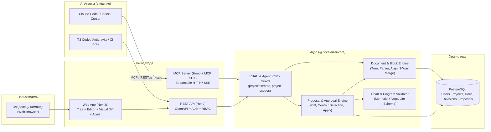
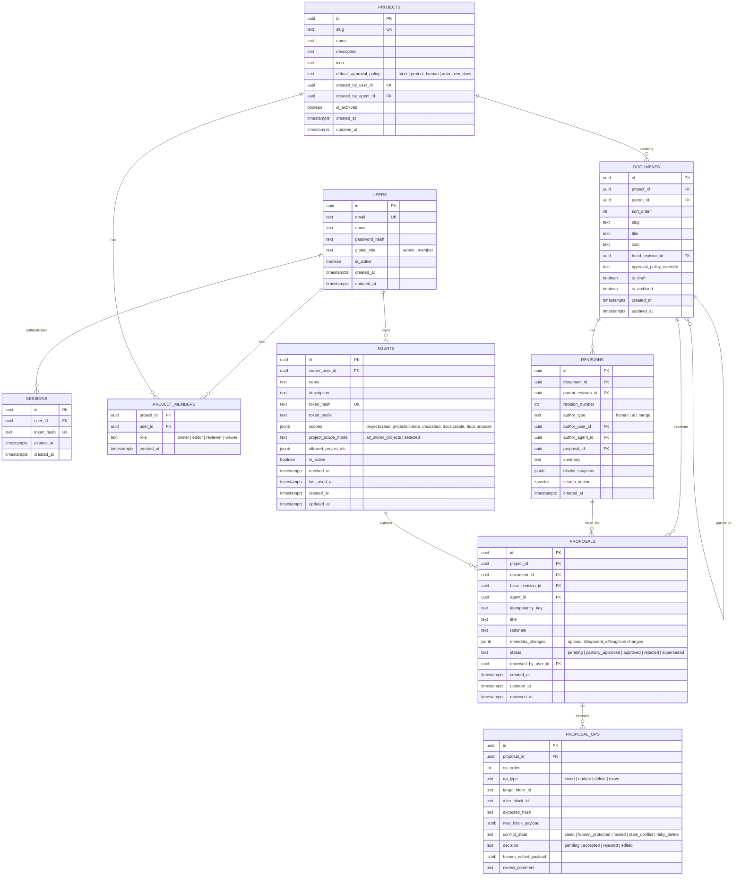

# Docalaizer — Архитектура сервиса

**Docalaizer** — open-source-ready сервис документации и визуализации данных в духе **Confluence / Coda**, но спроектированный с нуля под совместную работу людей и AI-агентов. AI-агенты могут создавать проекты (при наличии прав), вести дерево документации, рисовать структурные диаграммы и строить графики данных, но **никогда не перезаписывают ручные правки без явного аппрува в веб-интерфейсе**.

---

## 1. Зафиксированные архитектурные решения (ADR)

| Область | Решение | Обоснование |
|---|---|---|
| **Модель продукта** | **Confluence / Coda для AI-эпохи**: проекты → дерево вложенных страниц → типизированные блоки | Привычная навигация для документации проектов и фич, удобная одновременно человеку и LLM |
| **Пользователи и права** | Multi-user RBAC + гранулярные права AI-агентов (включая право `projects:create`) | Работает как личный self-hosted инструмент «из коробки» и готов к открытому доступу / командной работе |
| **Версионирование** | **Единая каноническая история (`main`) + AI Proposals + Блочное владение (`humanTouched`)** | Исключает расхождение двух историй, даёт поблочный cherry-pick и визуальный diff графиков |
| **Диаграммы и графики** | **Mermaid** (структура проекта/фич) + **Vega-Lite** (цифровые данные и графики) | Декларативные форматы, в которых LLM редко ошибаются; безопасный рендер без XSS и строгая валидация на сервере |
| **Хранилище** | **PostgreSQL** как единственный источник истины (JSONB-блоки + `tsvector` поиск) | Транзакции, оптимистичные блокировки, простота деплоя; экспорт в Markdown/Git/PDF добавляется позже поверх API |
| **Стек** | TypeScript-монорепа (`pnpm` + Turborepo): Next.js + Hono + Drizzle ORM + `@modelcontextprotocol/sdk` | Единые типы блоков, Zod-схемы и merge-движок между UI, API и MCP |

---

## 2. Высокоуровневая архитектура



---

## 3. Структура монорепозитория

```text
docalaizer/
├── apps/
│   ├── web/                  # Next.js (App Router), Tailwind, shadcn/ui, Editor, Visual Diff
│   └── api/                  # Hono server: REST API + MCP Streamable HTTP endpoint + Auth
├── packages/
│   ├── core/                 # Чистая доменная логика (без привязки к HTTP/БД):
│   │                         #   - схемы блоков (Zod)
│   │                         #   - парсер Markdown ↔ DocumentBlock[]
│   │                         #   - 3-way merge & conflict detector
│   │                         #   - валидаторы Mermaid / Vega-Lite
│   ├── db/                   # Drizzle ORM schema, миграции, seed-скрипты
│   └── shared/               # Общие DTO, типы ролей и скоупов, константы ошибок
├── docs/                     # Архитектурная документация
├── docker-compose.yml        # PostgreSQL + сборка для self-hosting
└── turbo.json / pnpm-workspace.yaml
```

---

## 4. Иерархия сущностей (Confluence / Coda модель)

1. **User (Пользователь)**: аккаунт человека (email/пароль или WebAuthn/passkey через LocuGard; при первом запуске в self-hosted режиме можно создать первого admin-пользователя).
2. **Project (Проект)**: изолированное пространство для одного продукта, сервиса или направления (например, *«Docalaizer»*, *«Billing Service»*, *«Личная база знаний»*).
   - Содержит настройки политики аппрувов по умолчанию (`strict` / `protect_human` / `auto_new_docs`).
   - Имеет список участников с ролями (`owner`, `editor`, `reviewer`, `viewer`).
   - Может быть создан человеком **или AI-агентом**, если у токена агента явно включено право `projects:create`.
3. **Document / Page (Страница в дереве)**:
   - Принадлежит проекту и может иметь родительскую страницу (`parent_id`), формируя вложенное дерево как в Confluence/Coda (например: `Архитектура` → `Авторизация` → `Схема токенов`).
   - Поддерживает `sort_order` для порядка в сайдбаре, `icon` (эмодзи/иконка) и теги.
4. **Block (Типизированный блок контента)**:
   - Каждая страница состоит из упорядоченного массива блоков со стабильными `block_id` (ULID).

```ts
export type BlockType =
  | 'markdown'   // Заголовок/текст/списки/код
  | 'diagram'    // Mermaid: архитектура, структура проекта, фича-флоу, ER, sequence
  | 'chart'      // Vega-Lite: графики цифровых данных + inline dataset
  | 'table'      // Табличные данные (Markdown/структурированная таблица)
  | 'callout';   // Инфо-блок, предупреждение, принятое решение (ADR)

export interface DocumentBlock {
  id: string;                 // Стабильный ULID блока
  type: BlockType;
  title?: string;             // Опциональный заголовок (удобно для графиков/диаграмм и diff)
  content: unknown;           // Markdown string | DiagramPayload | ChartPayload | TablePayload
  contentHash: string;        // SHA-256 от канонического content
  meta: {
    origin: 'human' | 'ai';
    lastEditedByType: 'human' | 'ai';
    lastEditorId: string;     // user_id или agent_id
    lastEditedAt: string;
    humanTouched: boolean;    // «Липкий» флаг: человек правил этот блок
    lockedByHuman: boolean;   // Явная блокировка блока от правок AI
  };
}
```

---

## 5. Подсистема диаграмм и графиков

Сервис закрывает два ключевых сценария визуализации:

### 5.1. Диаграммы структуры проекта и фич (`type: "diagram"`)
- **Движок MVP**: **Mermaid** (`flowchart`, `sequenceDiagram`, `erDiagram`, `stateDiagram-v2`, `classDiagram`, `C4Context`, `mindmap`).
- **Payload**:
  ```ts
  interface DiagramPayload {
    engine: 'mermaid';
    source: string;           // Исходный код диаграммы
    caption?: string;
  }
  ```
- **Безопасность и валидация**: проверка синтаксиса на сервере при приёме Proposal; рендер в браузере с `securityLevel: 'strict'` и кнопками Zoom/Pan/Fullscreen.

### 5.2. Графики цифровых данных (`type: "chart"`)
- **Движок MVP**: **Vega-Lite v5** (поддерживает line, bar, stacked bar, area, scatter, pie/arc, heatmap, multi-series, tooltips).
- **Payload**:
  ```ts
  interface ChartPayload {
    engine: 'vega-lite';
    spec: Record<string, unknown>; // Декларативная спецификация Vega-Lite (без JS-колбэков)
    data?: Record<string, unknown>[]; // Опционально вынесенный inline-датасет
    caption?: string;
  }
  ```
- **Почему Vega-Lite оптимален**:
  - Строгая JSON-схема → сервер мгновенно валидирует её через `ajv` / `vega-lite` compiler до создания Proposal и возвращает AI точную ошибку для самоисправления.
  - Нет исполняемого JS → нулевой риск XSS.
  - Inline-данные версионируются в снапшоте ревизии: график через полгода откроется ровно с теми же цифрами, которые были в момент ревью.
  - В Review Inbox человек видит **визуальный diff графиков (Было ↔ Стало)** и вкладку «Сравнить данные/спеку».

---

## 6. Пользователи, роли и права AI-агентов (RBAC)

### 6.1. Роли людей в проекте
- `owner` — полный доступ, настройки проекта, управление участниками, удаление проекта.
- `editor` — создание/правка страниц, аппрув/отклонение AI Proposals, управление замками блоков.
- `reviewer` — чтение, комментирование и аппрув AI Proposals (без удаления проекта).
- `viewer` — только чтение страниц и истории.

### 6.2. Модель прав AI-агентов (`agents`)
Каждый AI-агент регистрируется пользователем (например, «Claude Code — Laptop», «Cursor — Backend», «CI Metrics Bot») и получает **scoped Bearer-токен** (хранится в БД как SHA-256 хэш).

Агент действует **строго в пределах выданных скоупов**:
- `projects:read` — видеть список разрешённых проектов и их дерево документов.
- `projects:create` — **создавать новые проекты** от имени владельца токена (выключено по умолчанию; включается галочкой при создании токена).
- `docs:read` — читать документы и историю.
- `docs:create` — создавать новые страницы в разрешённых проектах (напрямую или через Proposal — зависит от `approval_policy` проекта).
- `docs:propose` — отправлять `Proposals` на изменение существующих страниц.
- `projectScope`:
  - `all_owner_projects` (все проекты пользователя, включая созданные агентом)
  - `selected` (явный белый список `allowed_project_ids`)

> **Важно**: при создании нового проекта через `projects:create` агент автоматически получает доступ к созданному им проекту (и его владельцем становится пользователь, выпустивший токен агента). При желании можно включить глобальную опцию «Новые проекты от AI требуют подтверждения».

---

## 7. Схема базы данных (PostgreSQL)



---

## 8. Безопасность, аудит и Self-Hosting

- **Аутентификация пользователей**: сессии в HttpOnly cookies с поддержкой email+password и опционального WebAuthn/passkey через LocuGard v0.1.0. Внешняя сессия LocuGard перепроверяется на каждом запросе; внешний аккаунт получает локальную роль `member`, а не автоматический `admin`.
- **Self-hosted режим**: настройка через `.env` (`ALLOW_PUBLIC_SIGNUP=false` для личного использования, `true` — для открытого доступа).
- **XSS-защита**: санитизация Markdown (`rehype-sanitize`), Mermaid `securityLevel: 'strict'`, декларативный Vega-Lite без произвольного JS, строгий CSP.
- **Защита от гонок**: обновление `documents.head_revision_id` выполняется в транзакции с оптимистичной проверкой (`WHERE id = $1 AND head_revision_id = $2`).
- **Лимиты (Quotas)**: ограничение размера inline-датасета графика (до 10 000 строк / 2 МБ) и размера Proposal, чтобы агент не мог перегрузить БД или браузер.

---

## Связанные документы

- [VERSIONING_AND_APPROVAL.md](./VERSIONING_AND_APPROVAL.md) — детальная механика версионирования, 3-way merge и аппрувов.
- [API_AND_MCP_SPEC.md](./API_AND_MCP_SPEC.md) — контракты MCP-инструментов и REST API.
- [ROADMAP.md](./ROADMAP.md) — поэтапный план реализации.
