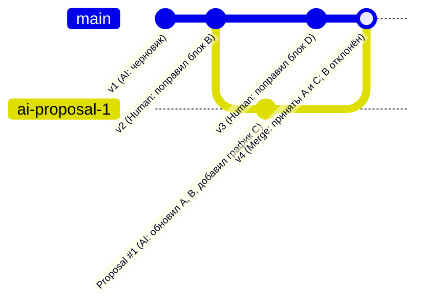
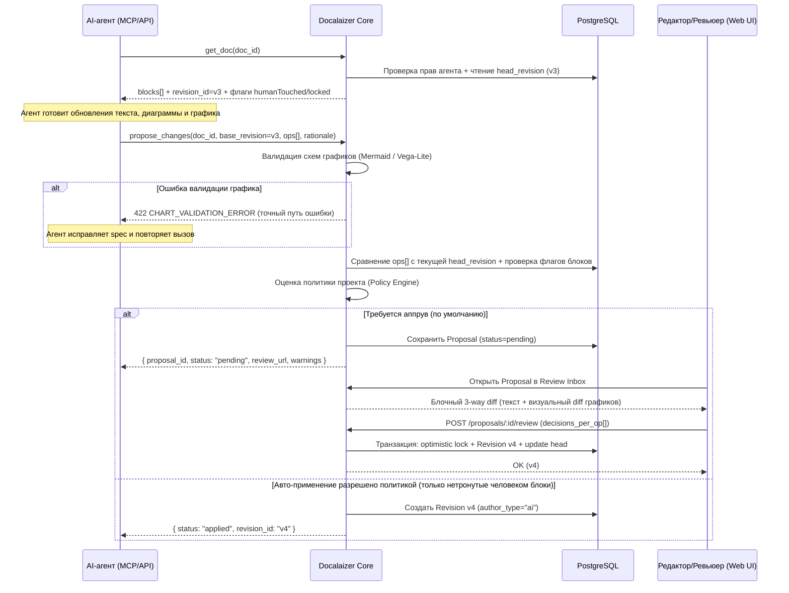
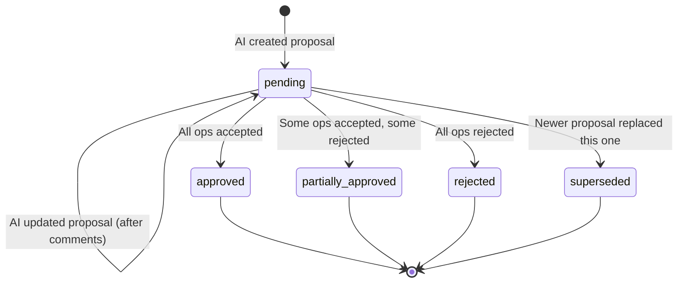

# Модель версионирования, защиты ручных правок и аппрувов

Этот документ отвечает на главный архитектурный вопрос сервиса: **как совмещать работу людей и AI-агентов в Confluence/Coda-документации так, чтобы AI никогда не перетирал ручные правки без аппрува, и при этом история оставалась понятной и без «ада слияний»**.

---

## 1. Почему «две отдельные истории» (Human vs AI) — плохая идея

Идея вести два параллельных потока версий (отдельно «история человека» и отдельно «история AI») на первый взгляд кажется логичной, но на практике быстро ломается по 4 причинам:

1. **Вечное расхождение (Divergence Hell)**: после 2–3 независимых правок две ветки начинают жить разной жизнью. Каждое новое слияние становится всё болезненнее.
2. **Потеря причинности**: непонятно, писал ли AI абзац *до* того, как человек поправил формулировку, или *после* (увидев правку).
3. **Поломка графиков и структур**: склеивать JSON-спецификации графиков (Vega-Lite) или Mermaid-диаграммы из двух разошедшихся историй текстовым 3-way merge почти невозможно — синтаксис ломается.
4. **Неясный источник истины**: какая версия «настоящая» при чтении документа, поиске или командной работе?

---

## 2. Сравнение архитектурных подходов

| Подход | Защита ручных правок | Работа с графиками | Сложность мерджа | Удобство UX |
|---|---|---|---|---|
| **Две независимые истории** (Human / AI) | Да, но нужно вручную мёрджить потоки | Плохо (конфликты JSON) | Очень высокая | Низкое |
| **Чистый Git / Markdown-ветки** | Да (через PR) | Средне (diff JSON нечитаем) | Средняя (строковые конфликты) | Среднее (тяжело для Confluence-опыта) |
| **Единая каноническая история + AI Proposals + Блочное владение** *(выбранный)* | **Гарантирована инвариантом сервера** | **Отлично (визуальный diff блоков)** | **Низкая (блочный 3-way merge)** | **Высокое (PR + Google Docs Suggestions)** |

---

## 3. Выбранная модель: Single Timeline + Proposals + Block Ownership

Архитектура объединяет три проверенные идеи:
1. **Единая каноническая история (`Main Timeline`)** — как `main` в Git. Есть одна актуальная версия документа (`head_revision`), и каждая ревизия неизменяема (immutable snapshot) с пометкой автора (`human`, `ai`, `merge`) и конкретным `author_user_id` / `author_agent_id`.
2. **Изолированные предложения AI (`Proposals`)** — как Pull Request в GitHub / режим предложений в Google Docs. AI-агент **не мутирует `main`**, а создаёт `Proposal`, привязанный к конкретной `base_revision_id`, которую он читал.
3. **Владение на уровне блоков (`Block Ownership`)** — документ разбит на блоки со стабильными `block_id`. Каждый блок знает, касалась ли его рука человека (`humanTouched`, `lockedByHuman`).

Что происходит на `v4`:
- Человек правил блок `D` параллельно с работой AI → блок `D` вообще не конфликтует с предложением AI.
- AI пытался изменить блок `B`, который ранее правил человек → сервер пометил блок `B` как `human_protected`, в UI он выделился предупреждением, и ревьюер нажал **«Отклонить»** на блок `B`, но **«Принять»** на блок `A` и новый график `C`.
- Итог в `main`: чистая единая история (`v1 → v2 → v3 → v4`), которую в любой момент можно отфильтровать по `human` / `ai` / `merge` и откатить целиком или поблочно.

---

## 4. Жизненный цикл правки от AI (Sequence)

---

## 5. Политики аппрува (Policy Matrix)

Политика задаётся на уровне **проекта** (`default_approval_policy`) и может переопределяться для отдельной страницы (`approval_policy_override`).

> **Жёсткий инвариант безопасности**: блок с `humanTouched = true` или `lockedByHuman = true` **НИКОГДА** не может быть изменён или удалён AI-агентом без явного аппрува пользователя (с ролью `owner` / `editor` / `reviewer`) в Web UI — независимо от выбранной политики.

| Режим политики | Новый документ от AI | Новый блок в существующем доке | Изменение AI-блока (`humanTouched=false`) | Изменение ручного блока (`humanTouched=true`) | Перемещение/переименование страницы |
|---|---|---|---|---|---|
| **`strict`** *(по умолчанию)* | Proposal (Inbox) | Proposal | Proposal | Proposal + предупреждение ⚠️ | Proposal |
| **`protect_human`** *(сбалансированный)* | Авто-публикация | Авто-публикация *(бейдж «Новое от AI»)* | Авто-публикация | **Строго Proposal** ⚠️ | Proposal |
| **`auto_new_docs`** | Авто-публикация | Proposal | Proposal | **Строго Proposal** ⚠️ | Proposal |

---

## 6. Блочный 3-Way Merge и матрица конфликтов

У каждой операции внутри Proposal есть `base_revision_id` и `expected_hash` блока на момент чтения агентом. При просмотре в Inbox и при нажатии «Применить ревью» сервер сравнивает три состояния блока:

- **Base** — состояние блока в `proposal.base_revision_id`
- **Head** — текущее состояние блока в `document.head_revision_id`
- **Proposed** — состояние, предложенное AI

| Ситуация | Условие | Статус в UI | Поведение по умолчанию |
|---|---|---|---|
| **Чистая правка AI-блока** | `Base == Head`, `humanTouched == false` | `clean` (зелёный) | Отмечено к принятию |
| **Правка ручного блока** | `Base == Head`, `humanTouched == true` | `human_protected` (янтарный) | По умолчанию **снята галочка** — требуется осознанный клик «Принять поверх ручной правки» |
| **Заблокированный блок** | `lockedByHuman == true` | `locked` (красный) | Применение заблокировано, пока пользователь не снимет замок |
| **Параллельный конфликт** | `Base != Head` (кто-то из людей поправил блок, пока Proposal ждал) | `stale_conflict` (красный) | Показывается сравнение `Текущая версия` vs `Предложение AI`; выбор версии или ручная доправка прямо в diff-экране |
| **Подозрительное удаление** | AI удаляет блок с `humanTouched == true` или сокращает >70% текста | `risky_delete` (красный) | Отклонено по умолчанию (защита от галлюцинации усечения LLM) |

### Жизненный цикл флага `humanTouched`
- Любой пользователь (`owner`/`editor`) правит блок в редакторе → `humanTouched = true`, `lastEditedByType = 'human'`, `lastEditorId = user.id`.
- Ревьюер **отклоняет** правку AI → блок не меняется, `humanTouched` сохраняется.
- Ревьюер **принимает** правку AI поверх ручного блока → по умолчанию `humanTouched` остаётся `true` (раздел уже признан важным для человека), но в меню блока всегда есть действие **«Передать блок под управление AI»** (`humanTouched = false`).
- Ревьюер **допиливает** предложение AI руками прямо в экране ревью (`decision = 'edited'`) → `humanTouched = true`.

---

## 7. Краевые случаи и командная работа

1. **Два AI-агента одновременно прислали Proposal в один документ**:
   - Оба Proposal спокойно лежат в Inbox со своими `base_revision_id`.
   - При аппруве Proposal #1 `head_revision` двигается вперёд (`v3 → v4`).
   - Proposal #2 динамически пересчитывает `conflict_state` относительно `v4` (lazy rebase): непересекающиеся блоки остаются `clean`, пересекающиеся переходят в `stale_conflict`.
2. **Два человека одновременно редактируют страницу**:
   - Ручное сохранение (`PATCH /docs/:docId`) тоже передаёт `expected_head_revision_id`. Если за это время страницу сохранил другой пользователь (или аппрувнул Proposal), сервер применяет тот же блочный 3-way merge: непересекающиеся блоки сливаются автоматически, а пересекающийся блок показывается пользователю как конфликт до перезаписи.
3. **Откат (Rollback)**:
   - Откат создаёт **новую** ревизию `v(N+1)` со снимком из `vK` (append-only история — аудит не теряется). Поддерживается откат как всей страницы, так и одного конкретного блока/графика.
4. **Диалог с AI по результатам ревью**:
   - Если человек отклонил часть блоков и оставил `review_comment` («Добавь на диаграмму сервис уведомлений и подпиши оси графика в мс»), агент через `get_proposal` читает комментарии и вызывает `update_proposal`.
5. **Статус-машина Proposal**:

